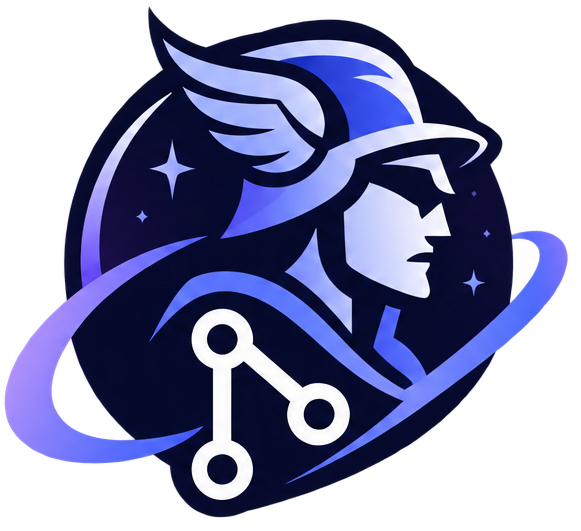

<p align="center">
  <picture>
    <source media="(prefers-color-scheme: dark)" srcset="branding/perseus-logo-white.png">
    
  </picture>
</p>

# Perseus

A fast, free and open-source visual Git client. Perseus is built with [Tauri](https://tauri.app)
(a Rust backend and the operating system's own web view) instead of Electron, so it starts quickly,
uses little memory and stays responsive on very large histories.

> **Status: first release (0.1.0).** Everyday Git, conflict resolution, interactive rebase and pull
> requests for GitHub and GitLab work and are covered by tests. Windows is the best tested platform;
> macOS builds as an app and a disk image and has been run; Linux builds in CI but has not been run by
> hand. Installers are not code-signed yet. See [What is not done yet](#what-is-not-done-yet).

## What it does

- **Commit graph** drawn on a canvas and streamed from Rust, so a repository with 100,000+ commits
  scrolls smoothly. Branch, tag and remote labels, a working-tree row, hide/solo for branches.
- **Everyday Git**: stage and unstage files, **single hunks and single lines**, commit, amend with a
  pre-filled message, co-author trailers, stash, tags, branches (create, rename, delete, check out),
  merge, rebase, cherry-pick, revert, reset, fetch / pull / push (including force-with-lease), with a
  confirmation step for anything that rewrites history.
- **Drag and drop** on the graph: drop a branch or commit on another to merge, rebase or cherry-pick,
  with a preview of conflicts before you agree.
- **Conflict resolver**: ours / theirs / both, or edit the result by hand.
- **Interactive rebase** editor: reorder, squash, fixup, drop, reword.
- **History tools**: file history, blame, search by message, author or content, patch export and apply.
- **Several repositories** as tabs; clone and init from the app; submodules, linked worktrees and Git LFS.
- **Identity profiles**: switch name, e-mail, SSH key, signing key and sign-in per profile, and have
  Perseus pick the right one by remote (`github.com/acme/*`). Git's global configuration is never
  modified.
- **Sign-in without friction**: GitHub and GitLab OAuth (device flow / PKCE), or paste a token.
  Secrets live in the operating system's keychain. Git and SSH password, passphrase and
  "trust this host?" questions are shown in a Perseus dialog and answered straight to the git
  process.
- **SSH commit signing** and signature badges, with in-app key generation.
- **Pull requests and issues** for GitHub and GitLab: list, create, check out, merge, with CI status.
- **Make it yours**: light, dark and system themes in two palettes, zoom, a command palette (`Ctrl+K`, `⌘K` on
  a Mac), **every keyboard shortcut rebindable**, and an interface in English or European Portuguese.
- **Accessible by design**: contrast checked against WCAG AA in every theme, keyboard-only use, the commit graph
  also offered to screen readers as a list, high-contrast modes ([details](docs/accessibility.md)).
- A log of every git command run.

No account is required, nothing is sent anywhere except to the Git hosts you talk to, and there is
no telemetry.

## Install and run

Prerequisites: [Git](https://git-scm.com), [Node.js](https://nodejs.org) 22+, [pnpm](https://pnpm.io)
(`corepack enable pnpm`), a [Rust](https://rustup.rs) toolchain and, on Windows, the WebView2 runtime (already
part of Windows 11). On macOS you need the Xcode command line tools (`xcode-select --install`). On Linux you
also need the packages listed in `.github/workflows/ci.yml`.

```bash
pnpm install
pnpm tauri dev            # development build with hot reload
pnpm tauri build          # installer in target/release/bundle (Windows: NSIS; macOS: Perseus.app and a .dmg)
```

## Checks

```bash
cargo fmt --all --check
cargo clippy --workspace --all-targets -- -D warnings
cargo test --workspace
pnpm test                 # Vitest
pnpm tauri build --no-bundle && pnpm e2e    # end-to-end tests against the release executable (Windows)
```

## Documentation

- [User guide](docs/user-guide.md)
- [Security notes for contributors](docs/security.md) and the [threat model](docs/threat-model.md)
- [OAuth providers](docs/oauth.md)
- [Performance notes](docs/performance.md)
- [Roadmap and status](docs/roadmap.md), and the [GitKraken comparison](docs/gitkraken-comparison.md)
- [Accessibility](docs/accessibility.md) and [localisation](docs/localisation.md)
- [Branding](docs/branding.md): the logos and how the app icons are made
- [Changelog](CHANGELOG.md) and [releasing](docs/releasing.md)
- [Contributing](CONTRIBUTING.md)

## What is not done yet

Perseus is not 1.0. The main gaps, all tracked in the [roadmap](docs/roadmap.md):

- **Release engineering that needs the owner**: code-signing certificates, macOS notarization, the
  auto-update signing key and the first public release. Until then installers are unsigned.
- **macOS** builds as `Perseus.app` and a `.dmg`, passes the test suite and has been launched; it is signed
  ad hoc only, so the first launch needs right-click → Open until the app is notarized. **Linux** builds in CI
  but has not been run by hand.
- No Bitbucket or Azure DevOps integration; no in-app terminal; no AI helpers (deliberately out of scope).
- Workspaces, in-app pull request review and GPG signing.
- A screen-reader pass (VoiceOver, NVDA) and the rest of the translation: most dialogs are still English
  ([accessibility](docs/accessibility.md), [localisation](docs/localisation.md)).

## License

[MIT](LICENSE).
